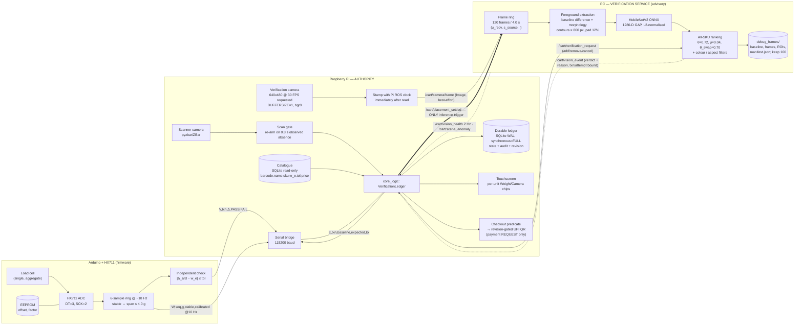
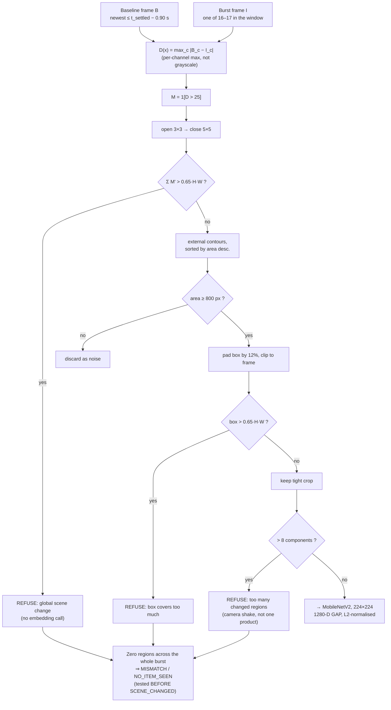

# NXTCart — Editable Figures, Tables, Captions, Equations and Pseudocode

Companion to `NXTCart_Manuscript.md`. Every artifact here is editable source: Mermaid for structural
diagrams (renderable as-is, or convertible to TikZ/Visio), LaTeX for equations and algorithms, and
pipe-delimited Markdown for tables (importable into CSV/Excel or `tabular`).

**Provenance rule applied throughout:** every number traces to a file in the repository at revision
`28aa58d3ceff6a7d03a2d208d9d4065606af85f8`, to a published source cited in the manuscript, or to an
explicit `[TO BE MEASURED: …]` placeholder. No value in this supplement was estimated.

---

## 1. Figure specifications

### Fig. 1 — System architecture and host boundaries

**Caption.** Fig. 1. NXTCart host boundaries. The Arduino performs calibrated acquisition and an
independent transaction-specific mass comparison; the Raspberry Pi owns both cameras, barcode
decoding, the catalogue, the durable per-unit ledger and checkout permission; the PC performs
foreground segmentation and local MobileNetV2 ONNX embedding comparison only. Dashed arrows carry
advisory verdicts. The PC can withhold approval but cannot grant it, alter a bill or authorise
payment. The import boundary (no `ml`/`torch`/`onnxruntime`/`nxtcart_vision` in the Pi package, no
`smart_cart` in the PC package) is enforced by a static check in CI.

**Layout notes for a drawing tool.** Three vertical swimlanes, left to right: Arduino (narrow),
Raspberry Pi (widest), PC. Place the two cameras at the top-left of the Pi lane. Keep the single
`/cart/placement_settled` arrow visually heavier than all others — it is the only inference trigger.



---

### Fig. 2 — Settlement-triggered burst timing (the paper's central figure)

**Caption.** Fig. 2. Timing of settlement-triggered evidence selection, drawn to the configured
defaults. `t_impact` is mechanical contact; `t_settled` is the host-clock stamp of the first stable,
calibrated sample whose deviation exceeds the 5 g noise gate. Because stability requires six
consecutive ~100 ms samples within a 4.0 g span, `t_settled − t_impact ≥ Δ_stab ≈ 0.5–0.6 s` even
for an instantly damped drop. The configured burst `[t_settled − 0.40 s, t_settled + 0.15 s]`
therefore observes the product **at rest**, not in descent, and the pre-entry baseline at
`t_settled − 0.90 s` remains clean only while `t_settled − t_impact < 0.90 s`. Shaded region: the
self-consistent operating band of (29).

**Layout notes.** A single horizontal time axis with `t_settled` at the origin. Mark, left to right:
`−1.05 s` and `−0.90 s` (baseline search window, 150 ms wide), `−0.40 s` (window start), `0`
(settlement), `+0.15 s` (window end), `+0.90 s` (transport-grace deadline). Draw 17 tick marks at
33.3 ms spacing across the window to show the expected frame count. Overlay a second, *unlabelled-
position* marker for `t_impact` with a horizontal uncertainty bar spanning 0.5–0.9 s to the left of
the origin — the uncertainty bar is the point of the figure.

```
ASCII reference rendering (replace with a vector drawing):

  source-timestamp axis (seconds relative to t_settled)
  ──┬───────┬────────────────┬──────────────────────────┬────┬──────────────────┬──→
  −1.05   −0.90            −0.40                        0  +0.15             +0.90
    └──────┘                 │                          │    │                 │
   baseline search        window                   t_settled │          transport-grace
   (δ_tol = 0.15 s)        start                             │           deadline
   newest match used    ├─ burst window: 16–17 frames @30 FPS ┤
                        ├ gap test includes BOTH edges (≤80 ms) ┤

  t_impact lies somewhere here, 0.5–0.9 s before t_settled:
                 ├────────── Δ_s uncertainty ──────────┤
            ↑ descent happens INSIDE this bar — i.e. BEFORE the window opens

  regimes:
    Δ_s ≤ 0.40 s   descent captured .......... UNREACHABLE (Δ_stab ≈ 0.5–0.6 s alone exceeds it)
    0.40 < Δ_s < 0.90  product at rest, baseline clean ......... VALID (shade this band)
    Δ_s ≥ 0.90 s   baseline already contains the product ....... CONTAMINATED
                   → empty difference mask → MISMATCH/NO_ITEM_SEEN (a mislabelled false reject)
```

---

### Fig. 3 — End-to-end sequence: scan → settle → verdict → checkout

**Caption.** Fig. 3. Message sequence for one successful placement. A barcode scan creates
verification context but never starts inference; the PC logs it and waits. Inference begins only on
`/cart/placement_settled`, whose `started_at` field carries the settled-sample timestamp. The PC does
not snapshot on the settlement callback, because the post-event frames may not yet have arrived and
the two topics may be delivered out of order.

```mermaid
sequenceDiagram
    autonumber
    participant S as Scanner cam (Pi)
    participant A as Authority (Pi)
    participant F as Firmware (Arduino)
    participant C as Verif. cam (Pi)
    participant P as Verifier (PC)
    participant G as Touchscreen (Pi)

    C->>P: /cart/camera/frame (continuous, best-effort, Pi-clock stamps)
    Note over P: ring: 120 frames / 4.0 s<br/>≥2 s of history needed before the first placement

    S->>A: /cart/scanned_item (barcode, scan_id)
    A->>A: catalogue lookup → (sku, w_e, tol, price); create unit (τ, a=1)
    A->>G: /cart/ui_display — row appears IMMEDIATELY, both chips amber
    A->>P: /cart/verification_request (add, τ, a, barcode, sku)
    Note over P: context stored; NO inference<br/>settlement_timeout = 18.0 s
    A->>F: E,τ,baseline_g,w_e,tol

    Note over F: shopper releases item → t_impact<br/>6 samples @ ~10 Hz within 4.0 g → stable
    F->>A: W,seq,g,stable=1,calibrated=1   (t_settled stamped on serial receipt)
    A->>A: Δ_pi = g − anchor; |Δ_pi − w_e| ≤ tol → CHECKING; anchor ← g
    A->>P: /cart/placement_settled (started_at = t_settled)
    F->>A: V,τ,Δ_ard,PASS
    A->>A: weight gate CHECKING → PASS (both checks agree)

    Note over P: wait until newest stamp ≥ t_settled+0.15 s,<br/>else until +0.75 s grace
    P->>P: baseline = newest frame ≤ t_settled−0.90 s (±0.15 s)
    P->>P: burst = all frames in [−0.40, +0.15]; require ≥12 frames, max gap ≤80 ms
    P->>P: per frame: difference → morphology → contours ≥800 px → pad 12%
    P->>P: per ROI: 1280-D embedding vs ALL SKUs; swaps ≻ matches ≻ failures
    P-->>A: /cart/vision_event (MATCH, τ, a, scores, reason)
    A->>A: camera gate → PASS (only if τ and a both match the current attempt)
    A->>G: /cart/ui_display — status VERIFIED, revision++

    G->>A: /cart/checkout_request {revision, request_id}
    A->>A: evaluate 9-condition predicate incl. |g − Σ measured_g| ≤ 10 g
    A-->>G: /cart/checkout_quote {allowed, amount, payee, revision}
    Note over G: UPI deep-link QR rendered locally.<br/>A payment REQUEST — no provider confirmation exists.
```

---

### Fig. 4 — Per-unit state machine

**Caption.** Fig. 4. Per-unit verification state. The two gates are independent and conjunctive:
`VERIFIED` requires both `PASS` for the **current** attempt, and `FAIL` on either gate is terminal
for that attempt. The firmware's `CHECKING` intermediate exists so that a Pi-side mass pass cannot
become `PASS` before the independent firmware comparison has arrived. A process restart forces every
non-`VERIFIED` unit to `FLAGGED`, so an interrupted verification can never be resurrected as billable.
Recovery from `FLAGGED` is always via selected removal, which increments the attempt counter.

```mermaid
stateDiagram-v2
    [*] --> VERIFYING : scan accepted, unit (τ, a=1) created
    state VERIFYING {
        [*] --> gates
        state gates {
            --
            W_PENDING --> W_CHECKING : |Δ_pi − w_e| ≤ tol
            W_PENDING --> W_FAIL : mass mismatch / overlap /<br/>scale not ready / unassigned mass
            W_CHECKING --> W_PASS : firmware V,τ,Δ,PASS
            W_CHECKING --> W_FAIL : firmware FAIL (terminal) or 20 s timeout
            --
            C_PENDING --> C_PASS : VisionEvent MATCH for this (τ, a)
            C_PENDING --> C_FAIL : MISMATCH / RETRY / UNAVAILABLE
        }
    }
    VERIFYING --> VERIFIED : W_PASS ∧ C_PASS
    VERIFYING --> FLAGGED : W_FAIL ∨ C_FAIL ∨ firmware FAIL
    VERIFIED --> REMOVING : shopper selects Remove (a ← a+1, both gates → PENDING)
    FLAGGED --> REMOVING : shopper selects Remove (a ← a+1)
    REMOVING --> [*] : negative mass step matches AND removal identity matches
    REMOVING --> FLAGGED : either removal gate fails → empty-cart reconciliation required
    VERIFYING --> FLAGGED : process restart (any non-VERIFIED unit is failed on load)
    VERIFIED --> FLAGGED : observation gap (camera restart, PC heartbeat loss, scale restart)
```

---

### Fig. 5 — Foreground-only ROI pipeline

**Caption.** Fig. 5. Why no full frame reaches the network. Each burst frame is differenced against
the pre-entry baseline using the per-channel maximum (9), thresholded at 25 (10), opened 3×3 then
closed 5×5 (11), and split into external contours. Components below 800 px are discarded; each
surviving component gets its own 12 %-padded crop (13). Components are never merged, so a hand and a
product at opposite corners remain two tight crops rather than one scene-sized box. A mask covering
more than 65 % of the frame (12), a padded box exceeding the same fraction (14), or more than eight
surviving components are refusals, not inputs. For a selected removal the roles invert and crops are
taken from the **baseline**, where the departing product still is.



---

### Fig. 6 — Settlement-delay feasibility band

**Caption.** Fig. 6. Feasibility of the configured burst as a function of the impact-to-settlement
delay `Δ_s = t_settled − t_impact`. Region I (`Δ_s ≤ 0.40 s`) would capture the descent but is
unreachable with the shipped firmware, whose stability window alone contributes ≈0.5–0.6 s. Region II
(`0.40 s < Δ_s < 0.90 s`) is the self-consistent operating band: the product is observed at rest and
the baseline is pre-entry. Region III (`Δ_s ≥ 0.90 s`) contaminates the baseline with the product
itself, collapsing the difference mask and producing a `MISMATCH`/`NO_ITEM_SEEN` false reject. The
firmware floor leaves roughly 0.30–0.40 s of mechanical-decay budget. The empirical distribution of
`Δ_s` is `[TO BE MEASURED: ≥200 drops, stratified by mass decile, on the mounted cart, using an
independent impact reference]`.

**Plot specification.** Horizontal axis `Δ_s` from 0 to 1.4 s. Three shaded vertical bands with the
boundaries above. Overlay (i) a hatched exclusion zone from 0 to ≈0.5 s labelled "firmware floor
Δ_stab", and (ii) a placeholder histogram outline in Region II/III labelled with the placeholder
above — draw it as a dashed outline so no reader mistakes it for data. Annotate the Region II width
(0.50 s) and the usable decay budget (0.90 − 0.60 = 0.30 s worst case, 0.90 − 0.50 = 0.40 s best
case).

**Do not** publish this figure with a filled histogram until `Δ_s` has been measured.

---

## 2. Equations (LaTeX source)

```latex
% (1) Ring memory, analytical, raw BGR payload only
M_{\mathrm{ring}} = N_{\mathrm{buf}}\cdot W\cdot H\cdot 3
  = 120\cdot 640\cdot 480\cdot 3\ \mathrm{B} = 110.6\ \mathrm{MB}

% (2) Image-topic bandwidth, analytical, excludes DDS/IP/framing overhead
B_{\mathrm{net}} = W\cdot H\cdot 3\cdot f
  = 640\cdot 480\cdot 3\cdot 30\ \mathrm{B/s} = 27.6\ \mathrm{MB/s} \approx 221\ \mathrm{Mb/s}

% (3) Burst window
\mathcal{W}(t_s) = [\,t_s-\delta_{\mathrm{pre}},\; t_s+\delta_{\mathrm{post}}\,],
  \qquad \delta_{\mathrm{pre}}=0.40\,\mathrm{s},\ \delta_{\mathrm{post}}=0.15\,\mathrm{s}

% (4) Baseline target
b(t_s) = t_s - \delta_{\mathrm{base}}, \qquad \delta_{\mathrm{base}} = 0.90\,\mathrm{s}

% (5) Baseline candidate set; the NEWEST element is used
\mathcal{B} = \{\,(u,s,I)\in\mathcal{F} \;:\; b-\delta_{\mathrm{tol}} \le s \le b\,\},
  \qquad \delta_{\mathrm{tol}} = 0.15\,\mathrm{s}

% (6)-(8) Admissibility
\mathcal{B}\neq\emptyset
\qquad |\mathcal{S}| \ge n_{\min}=12
\qquad \max_i \big(\tilde{s}_{i+1}-\tilde{s}_i\big) \le g_{\max}=80\,\mathrm{ms}
\quad\text{where}\quad
\tilde{s} = \big[\,t_s-\delta_{\mathrm{pre}},\,s_1,\dots,s_{|\mathcal{S}|},\,t_s+\delta_{\mathrm{post}}\,\big]

% (9) Per-channel maximum difference
D(\mathbf{x}) = \max_{c\in\{B,G,R\}} \big| B_c(\mathbf{x}) - I_c(\mathbf{x}) \big|

% (10) Threshold
M(\mathbf{x}) = \mathbb{1}\!\left[\, D(\mathbf{x}) > \tau_d \,\right], \qquad \tau_d = 25

% (11) Morphology
M' = \mathrm{close}_{5\times5}\!\big(\mathrm{open}_{3\times3}(M)\big)

% (12) Global-change refusal
\textstyle\sum_{\mathbf{x}} M'(\mathbf{x}) > \rho\,H\,W,\quad \rho = 0.65
  \;\;\Rightarrow\;\; \text{refuse}

% (13) ROI padding, p = 0.12
x_0 = \max(0, x-\lceil pw\rceil),\quad y_0 = \max(0, y-\lceil ph\rceil),\quad
x_1 = \min(W, x+w+\lceil pw\rceil),\quad y_1 = \min(H, y+h+\lceil ph\rceil)

% (14) Box-size refusal
(x_1-x_0)(y_1-y_0) > \rho\,H\,W \;\;\Rightarrow\;\; \text{refuse}

% (15) Embedding
\mathbf{z} = \mathrm{GAP}\!\big(\mathrm{MobileNetV2}_{\text{body}}(\mathrm{norm}(\mathrm{crop}))\big)
  \in\mathbb{R}^{1280}, \qquad \mathbf{e} = \mathbf{z}/\lVert\mathbf{z}\rVert_2

% (16) Appearance similarity: max cosine over that SKU's references
s(k,\mathbf{e}) = \mathrm{clip}\!\left(\max_j \langle \mathbf{r}_{k,j}, \mathbf{e}\rangle, -1, 1\right)

% (17) Colour-histogram score, 80-bin HSV fingerprint
c(k,\mathrm{crop}) = \mathrm{clip}\!\left(\max_j
  \big\langle \mathbf{h}_{k,j}, \mathbf{h}(\mathrm{crop})\big\rangle, 0, 1\right),
  \qquad \text{colour\_ok} \iff c \ge 0.30

% (18) Optional expected mean BGR colour
c_{\mathrm{bgr}} = 1 - \frac{\lVert \mathrm{mean}(\mathrm{crop}) - \boldsymbol{\mu}_k \rVert_2}{255\sqrt{3}},
  \qquad \text{colour\_ok} \iff c_{\mathrm{bgr}} \ge 0.30

% (19) Apparent aspect ratio — IMAGE-PLANE ONLY, NOT a physical size measurement
\alpha = \frac{\max(h,w)}{\min(h,w)}, \qquad
\text{size\_ok} \iff \exists j:\ \max\!\left(\frac{\alpha}{\rho_j}, \frac{\rho_j}{\alpha}\right) \le 3.0

% (20)-(22) Per-region decision, k* = scanned SKU, k_1 = top-1, m = s_1 - s_2
\begin{cases}
\textsc{mismatch}/\texttt{SWAP\_DETECTED} & k_1 \neq k^* \ \wedge\ s_1 \ge \theta_{\mathrm{swap}} = 0.70\\[2pt]
\textsc{match} & k_1 = k^* \ \wedge\ s_1 \ge \theta = 0.72 \ \wedge\ m \ge \mu = 0.04
                 \ \wedge\ \text{colour\_ok} \wedge \text{size\_ok}\\[2pt]
\textsc{mismatch}/\texttt{LOW\_CONFIDENCE} & \text{otherwise}
\end{cases}

% (23) Burst aggregation: lexicographic precedence, NOT a vote
\mathcal{P} =
\begin{cases}
\mathcal{S}\mathrm{w} & \mathcal{S}\mathrm{w} \neq \emptyset \quad\text{(swaps veto)}\\
\mathcal{M} & \mathcal{S}\mathrm{w} = \emptyset,\ \mathcal{M} \neq \emptyset\\
\mathcal{L} & \text{otherwise}
\end{cases}
\qquad
\hat{r} = \arg\max_{r\in\mathcal{P}} \mathrm{score}(r)

% (24) Firmware stability test
\mathrm{stable} \iff \mathrm{calibrated} \ \wedge\ |\mathrm{ring}| = 6
  \ \wedge\ \big(\max \mathrm{ring} - \min \mathrm{ring}\big) \le \sigma = 4.0\,\mathrm{g}

% (25) Firmware mass check (independent code path, Pi-supplied baseline)
\Delta_{\mathrm{ard}} = \mathrm{reading} - \mathrm{baseline\_g},
  \qquad \textsc{pass} \iff \big|\Delta_{\mathrm{ard}} - w_e\big| \le \mathrm{tol}

% (26) Pi mass check (independent code path, ledger anchor)
\Delta_{\mathrm{pi}} = g - \mathrm{anchor},
  \qquad \textsc{pass} \iff \big|\Delta_{\mathrm{pi}} - w_e\big| \le \mathrm{tol}

% (27)-(28) Timing feasibility conditions
\text{descent in window} \iff \Delta_s \le \delta_{\mathrm{pre}} = 0.40\,\mathrm{s}
\qquad
\text{baseline pre-entry} \iff \Delta_s < \delta_{\mathrm{base}} = 0.90\,\mathrm{s}

% (29) Self-consistent operating band, with Delta_s = (t_q - t_0) + Delta_stab + Delta_serial
0.40\,\mathrm{s} \;<\; \Delta_s \;<\; 0.90\,\mathrm{s},
  \qquad \Delta_{\mathrm{stab}} \in [0.5, 0.6]\,\mathrm{s}
```

**Proposed (not implemented) equations.** The following appear nowhere in the code and must be
labelled as proposals if used:

```latex
% P1 (PROPOSED) separately published impact timestamp from a first-derivative crossing
t_{\mathrm{impact}} \approx \min\Big\{ t \;:\; \big|\tfrac{\mathrm{d}g}{\mathrm{d}t}(t)\big| > \gamma \Big\}

% P2 (PROPOSED) adaptive baseline offset driven by the measured Delta_s distribution
\delta_{\mathrm{base}}^{\star} = \mathrm{quantile}_{0.99}(\Delta_s) + \Delta_{\mathrm{margin}}

% P3 (PROPOSED) risk-coverage reporting for the abstaining verifier
\mathrm{risk}(\kappa) = \frac{\#\{\text{accepted} \wedge \text{incorrect}\}}{\#\{\text{accepted}\}},
\qquad
\mathrm{coverage}(\kappa) = \frac{\#\{\text{decided}\}}{\#\{\text{attempts}\}},
\qquad \kappa = (\theta,\mu,\theta_{\mathrm{swap}})
```

---

## 3. Pseudocode (LaTeX `algorithmic` source)

### Algorithm 1 — Settlement-triggered burst assembly (PC)

```latex
\begin{algorithm}
\caption{Settlement-triggered burst assembly (PC verification node)}
\begin{algorithmic}[1]
\Require settlement message $m=(\tau,a,\text{barcode},\text{sku},\text{action},t_s)$;
         frame ring $\mathcal{F}$;
         $\delta_{\mathrm{pre}},\delta_{\mathrm{post}},\delta_{\mathrm{base}},\delta_{\mathrm{tol}},
          n_{\min},g_{\max},T_{\mathrm{grace}},T_{\mathrm{buf}}$
\Ensure  a submitted inference job, or a \textsc{retry}/\textsc{unavailable} verdict
\Statex \textbf{On \texttt{/cart/placement\_settled}:}
\If{$(\tau,a)$ is completed, running or collecting} \State \Return \Comment{idempotent}
\EndIf
\State $c \gets \textsc{PendingPop}(\tau,a)$ \textbf{or} $\textsc{ContextFrom}(m)$
\If{$\textsc{Identity}(c) \neq \textsc{Identity}(m)$}
  \State \textsc{Publish}(\textsc{retry}, "settlement does not match requested transaction");
  \Return
\EndIf
\If{$\textsc{Resolve}(\text{sku},\text{barcode}) = \bot$}
  \State \textsc{Publish}(\textsc{unavailable}, "unknown barcode/SKU"); \Return
\EndIf
\State $\mathrm{age} \gets \textsc{HostClockNow}() - t_s$
\If{$\mathrm{age} \notin [-0.1,\,T_{\mathrm{buf}}]$}
  \State \textsc{Publish}(\textsc{retry}, "stale settlement; check clock sync"); \Return
\EndIf
\If{$|\mathrm{collecting}| + |\mathrm{running}| \ge 8$}
  \State \textsc{Publish}(\textsc{retry}, "image verification queue full"); \Return
\EndIf
\State $w \gets \max(0,\ \delta_{\mathrm{post}} - \mathrm{age})$
\State $\mathrm{collecting}[(\tau,a)] \gets (c,\ t_s,\ \mathrm{ready}=\mathrm{now}+w,\
        \mathrm{deadline}=\mathrm{now}+w+T_{\mathrm{grace}})$
\Statex \textbf{On every 20\,Hz tick:}
\ForAll{$(\tau,a) \in \mathrm{collecting}$}
  \State $\mathrm{covered} \gets (\text{newest source stamp} \ge t_s+\delta_{\mathrm{post}})$
  \If{$\mathrm{now} < \mathrm{ready}$ \textbf{or} ($\neg\mathrm{covered}$ \textbf{and}
       $\mathrm{now} < \mathrm{deadline}$)}
    \State \textbf{continue} \Comment{keep receiving; do not snapshot on the callback}
  \EndIf
  \State remove $(\tau,a)$ from $\mathrm{collecting}$
  \State $\mathcal{B} \gets \{f\in\mathcal{F} :
          t_s-\delta_{\mathrm{base}}-\delta_{\mathrm{tol}} \le \mathrm{stamp}(f)
          \le t_s-\delta_{\mathrm{base}}\}$
  \State $\mathcal{S} \gets \{f\in\mathcal{F} :
          t_s-\delta_{\mathrm{pre}} \le \mathrm{stamp}(f) \le t_s+\delta_{\mathrm{post}}\}$
  \If{$\mathcal{B} = \emptyset$}
    \State \textsc{Publish}(\textsc{retry}, "pre-entry baseline unavailable"); \textbf{continue}
  \EndIf
  \State $\mathrm{gaps} \gets \textsc{Diffs}\big([t_s-\delta_{\mathrm{pre}}]
          \,\|\,\mathrm{stamps}(\mathcal{S})\,\|\,[t_s+\delta_{\mathrm{post}}]\big)$
  \If{$|\mathcal{S}| < n_{\min}$ \textbf{or} $\max(\mathrm{gaps}) > g_{\max}$}
    \State \textsc{Publish}(\textsc{retry}, "incomplete placement burst"); \textbf{continue}
  \EndIf
  \State \textsc{SubmitToSingleWorker}\big(\textsc{VerifyBurst},\ \textsc{Newest}(\mathcal{B}),\
          \mathcal{S},\ c\big)
\EndFor
\end{algorithmic}
\end{algorithm}
```

### Algorithm 2 — Foreground ROI extraction

```latex
\begin{algorithm}
\caption{Foreground ROI extraction (no full frame is ever embedded)}
\begin{algorithmic}[1]
\Require baseline $B$, frame $I$, thresholds $\tau_d,A_{\min},p,\rho$,
         $\mathrm{action}\in\{\textsf{placed},\textsf{removed}\}$
\Ensure  crops and boxes, or a rejection reason
\If{$\mathrm{action} = \textsf{removed}$}
  \State $\textsc{Swap}(B, I)$
  \Comment{the departing product is in the baseline; crop from there, never the empty basket}
\EndIf
\If{$\mathrm{shape}(B) \neq \mathrm{shape}(I)$}
  \State \Return \textsc{reject}("frame geometry changed")
\EndIf
\State $M \gets \mathbb{1}\big[\max_c |B_c - I_c| > \tau_d\big]$
  \Comment{per-channel max preserves equally bright, differently coloured changes}
\State $M \gets \textsc{Close}_{5\times5}\big(\textsc{Open}_{3\times3}(M)\big)$
\If{$\textsc{NonZero}(M) > \rho\,H\,W$}
  \State \Return \textsc{reject}("global scene change")
\EndIf
\State $\mathcal{C} \gets$ external contours of $M$, sorted by area descending
\State $\mathrm{crops},\mathrm{boxes} \gets [\,],[\,]$
\ForAll{$\kappa \in \mathcal{C}$}
  \If{$\textsc{Area}(\kappa) < A_{\min}$} \State \textbf{continue} \Comment{noise} \EndIf
  \State $\beta \gets \textsc{Clip}\big(\textsc{Pad}(\textsc{BoundingRect}(\kappa), p)\big)$
  \If{$\textsc{Area}(\beta) > \rho\,H\,W$}
    \State \Return \textsc{reject}("foreground box covers too much of the scene")
  \EndIf
  \State append $\beta$ to $\mathrm{boxes}$;\ \ append $\textsc{Crop}(I,\beta)$ to $\mathrm{crops}$
  \Comment{components are NEVER merged}
\EndFor
\If{$|\mathrm{crops}| > 8$}
  \State \Return \textsc{reject}("too many changed regions")
  \Comment{camera shake, not one inserted product; fail closed}
\EndIf
\State \Return $\mathrm{crops}, \mathrm{boxes}$
\end{algorithmic}
\end{algorithm}
```

### Algorithm 3 — Burst verification with all-SKU competition and veto

```latex
\begin{algorithm}
\caption{Burst verification: all-SKU competition with a burst-level substitution veto}
\begin{algorithmic}[1]
\Require scanned SKU $k^*$; per-frame region lists $\{\mathcal{R}_i\}$;
         reference DB $\{\mathbf{r}_{k,j}\}_{k\in\mathcal{K}}$;
         $\theta=0.72,\ \mu=0.04,\ \theta_{\mathrm{swap}}=0.70$
\Ensure  one burst verdict plus a per-region evaluation record
\If{$k^* \notin \mathcal{K}$}
  \State \Return \textsc{unavailable}("no reference embeddings for scanned SKU")
\EndIf
\State $\mathcal{E},\ \mathcal{S}\mathrm{w},\ \mathcal{M},\ \mathcal{L} \gets [\,],[\,],[\,],[\,]$
\For{$i \gets 0$ \textbf{to} $|\{\mathcal{R}_i\}|-1$}
  \For{$j \gets 0$ \textbf{to} $|\mathcal{R}_i|-1$}
    \State $x \gets \mathcal{R}_i[j]$
    \If{$x$ invalid \textbf{or} $\min(h,w) < 8$}
      \State record \textsc{unavailable} for $(i,j)$; \textbf{continue}
    \EndIf
    \State $\mathbf{e} \gets \textsc{Normalise}(\textsc{Embed}(x))$
      \Comment{(15); single worker, so \texttt{cv2.dnn} is never re-entered}
    \State $\mathrm{ranked} \gets \textsc{SortDesc}\big[\,(s(k,\mathbf{e}), c(k,x), \mathrm{ok}(k,x), k)
            \ :\ k \in \mathcal{K}\,\big]$
      \Comment{EVERY SKU, deterministic key tie-break}
    \State $(s_1,c_1,\mathrm{ok}_1,k_1) \gets \mathrm{ranked}[0]$;\quad
           $s_2 \gets \mathrm{ranked}[1].s$;\quad $m \gets s_1-s_2$
    \If{$k_1 \neq k^*$ \textbf{and} $s_1 \ge \theta_{\mathrm{swap}}$}
      \State append $\textsc{Swap}(k_1,s_1)$ to $\mathcal{S}\mathrm{w}$
    \ElsIf{$k_1 = k^*$ \textbf{and} $s_1 \ge \theta$ \textbf{and} $m \ge \mu$
           \textbf{and} $\mathrm{ok}_1$}
      \State append $\textsc{Match}(k^*,s_1)$ to $\mathcal{M}$
    \Else
      \State append $\textsc{LowConfidence}(k^*,s_1)$ to $\mathcal{L}$
    \EndIf
    \State record $(i,j,k_1,s_1,s(k^*,\mathbf{e}),k_2,s_2,m,c_1,\mathrm{ok}_1)$ in $\mathcal{E}$
  \EndFor
\EndFor
\State $\mathcal{P} \gets \mathcal{S}\mathrm{w}$ \textbf{if} $\mathcal{S}\mathrm{w}\neq\emptyset$
       \textbf{else} $\mathcal{M}$ \textbf{if} $\mathcal{M}\neq\emptyset$ \textbf{else} $\mathcal{L}$
  \Comment{(23): a confident swap anywhere vetoes every match}
\If{$\mathcal{P} = \emptyset$}
  \State \Return \textsc{unavailable}/\texttt{NO\_EMBEDDING} with $\mathcal{E}$
\EndIf
\State \Return $\arg\max_{r\in\mathcal{P}} \mathrm{score}(r)$ with $\mathcal{E}$ attached
\end{algorithmic}
\end{algorithm}
```

### Algorithm 4 — Checkout predicate (Pi authority)

```latex
\begin{algorithm}
\caption{Checkout predicate (evaluated on the Pi; returns the first blocking reason)}
\begin{algorithmic}[1]
\Require ledger $\mathcal{U}$, latest mass $g$, anchor, revision $\nu$, request revision $\nu_q$
\Ensure  $\varepsilon$ (allowed) or a human-readable blocking reason
\If{$\mathcal{U} = \emptyset$} \State \Return "cart is empty" \EndIf
\If{$\neg\mathrm{ready}$ \textbf{or} $\mathrm{recovery}$}
  \State \Return "scale recovery: empty the cart and select Remove" \EndIf
\If{$\neg\mathrm{sensor\_ok}$ \textbf{or} $\neg\mathrm{scale\_stable}$}
  \State \Return "waiting for a fresh stable scale reading" \EndIf
\If{PC heartbeat age $> 2.5$\,s} \State \Return "camera verification service unavailable" \EndIf
\If{$\mathrm{issue} \neq \varepsilon$} \State \Return $\mathrm{issue}$
  \Comment{unassigned mass, overlap, capacity, observation gap} \EndIf
\If{$\exists u \in \mathcal{U} : \mathrm{status}(u) \neq \textsc{verified}$}
  \State \Return "every item must pass weight and camera verification" \EndIf
\If{$\big|g - \sum_{u} \mathrm{measured\_g}(u)\big| > 10$\,g}
  \State \Return "cart weight is not reconciled with verified items"
  \Comment{aggregate check ON TOP of per-unit checks} \EndIf
\If{merchant UPI address unset} \State \Return "configure merchant UPI address" \EndIf
\If{$\nu_q \neq \nu$} \State \Return "cart changed; try checkout again" \EndIf
\State \Return $\varepsilon$
  \Comment{the GUI additionally enforces 1.5\,s freshness and \texttt{request\_id} matching}
\end{algorithmic}
\end{algorithm}
```

---

## 4. Editable table sources

All tables below are the pipe-delimited sources also embedded in the manuscript. Convert to CSV by
replacing ` | ` with a delimiter, or to `tabular`/`booktabs` with any Markdown→LaTeX converter.
TABLE I and TABLE IX are wide; in a two-column IEEE layout use `table*` with `\footnotesize` or split
TABLE I into "cart systems" and "vision systems" halves at the row marked below.

| Table | Title | Manuscript section | Suggested LaTeX float | Notes |
|---|---|---|---|---|
| I | Comparison of cart and checkout systems | II-G | `table*`, `\scriptsize`, landscape optional | Split after the `[27]` row if two pages are needed |
| II | Derived design requirements and status | III-E | `table` | Fits one column at `\footnotesize` |
| III | ROS 2 interface contract | IV-B | `table*` | Keep the QoS column — it is load-bearing for §V-A |
| IV | Verdict and reason codes | V-H | `table*` | The two "implementation details" notes must travel with it |
| V | Hardware/software inventory | VI-A | `table*` | Preserve every "requested" qualifier |
| VI | Configured defaults | VI-B | `table`, two-column spill | Caption must retain "require empirical validation" |
| VII | Baselines | VII-B | `table` | — |
| VIII | Mechanism ablations | VII-C | `table` | One row per claimed contribution |
| IX | Scenario matrix | VII-D | `table*`, `\scriptsize` | Keep the out-of-scope rows (S16, S28, S29) visible |
| X | Metrics and denominators | VII-E | `table*` | Denominator column is mandatory |
| XI | Software-check results | VIII-A | `table` | The only table containing measured values |

### Results skeletons to be filled after the campaign

These are the empty result tables the protocol produces. They are deliberately shipped empty.

**TABLE XII (skeleton). Per-scenario outcomes by baseline.** One block per scenario class from
TABLE IX. Do not merge honest and adversarial rows into a single accuracy figure.

| Scenario class | n (attempts) | n (units) | n (sessions) | B0 barcode | B1 +weight | B2 +vision | B3 full | B4 fused |
|---|---|---|---|---|---|---|---|---|
| Honest additions (S1) | `[TO BE MEASURED]` | `[ ]` | `[ ]` | `[ ]` | `[ ]` | `[ ]` | `[ ]` | `[ ]` |
| Honest removals (S9) | `[ ]` | `[ ]` | `[ ]` | `[ ]` | `[ ]` | `[ ]` | `[ ]` | `[ ]` |
| Different-mass swap (A1/S2) | `[ ]` | `[ ]` | `[ ]` | `[ ]` | `[ ]` | `[ ]` | `[ ]` | `[ ]` |
| Equal-mass swap (A2/S3) | `[ ]` | `[ ]` | `[ ]` | `[ ]` | `[ ]` | `[ ]` | `[ ]` | `[ ]` |
| Lookalike variant (A3/S4) | `[ ]` | `[ ]` | `[ ]` | `[ ]` | `[ ]` | `[ ]` | `[ ]` | `[ ]` |
| Unscanned insertion (A4/S5) | `[ ]` | `[ ]` | `[ ]` | `[ ]` | `[ ]` | `[ ]` | `[ ]` | `[ ]` |
| Removal fraud (A6/S10) | `[ ]` | `[ ]` | `[ ]` | `[ ]` | `[ ]` | `[ ]` | `[ ]` | `[ ]` |
| Nuisance set (S11–S15) | `[ ]` | `[ ]` | `[ ]` | `[ ]` | `[ ]` | `[ ]` | `[ ]` | `[ ]` |

Each cell: FAR or false-reject rate as appropriate, with a 95 % Clopper–Pearson interval and the
cell's own denominator. Never report a bare percentage.

**TABLE XIII (skeleton). Ablation deltas against B3**, replayed offline on identical recorded bursts.

| Ablation | Δ FAR (pp) | Δ honest false reject (pp) | Δ retry rate (pp) | Δ p95 latency (ms) | Verdict on the mechanism |
|---|---|---|---|---|---|
| A-FG (full-frame embedding) | `[ ]` | `[ ]` | `[ ]` | `[ ]` | `[ ]` |
| A-ALL (expected-SKU only) | `[ ]` | `[ ]` | `[ ]` | `[ ]` | `[ ]` |
| A-VETO (any match wins) | `[ ]` | `[ ]` | `[ ]` | `[ ]` | `[ ]` |
| A-MARGIN (μ = 0) | `[ ]` | `[ ]` | `[ ]` | `[ ]` | `[ ]` |
| A-COLOUR (no colour/aspect) | `[ ]` | `[ ]` | `[ ]` | `[ ]` | `[ ]` |
| A-DENSITY (no density/gap test) | `[ ]` | `[ ]` | `[ ]` | `[ ]` | `[ ]` |
| A-BASE (baseline just before settlement) | `[ ]` | `[ ]` | `[ ]` | `[ ]` | `[ ]` |
| A-SAMPLE (5-frame decimation) | `[ ]` | `[ ]` | `[ ]` | `[ ]` | `[ ]` |
| A-TRIG (scan-triggered forward window) | `[ ]` | `[ ]` | `[ ]` | `[ ]` | `[ ]` |

**TABLE XIV (skeleton). Timing and transport**, from `manifest.json` and wire measurement.

| Quantity | p50 | p95 | max | n | Source |
|---|---|---|---|---|---|
| `Δ_s = t_settled − t_impact` | `[ ]` | `[ ]` | `[ ]` | `[ ]` | Independent impact reference |
| Realised burst frame count | `[ ]` | `[ ]` | `[ ]` | `[ ]` | `manifest.frame_count` |
| Realised max intra-burst gap (ms) | `[ ]` | `[ ]` | `[ ]` | `[ ]` | `manifest.max_gap_ms` |
| Burst admissibility rate | — | — | — | `[ ]` | verdict log |
| ROI count per admissible burst | `[ ]` | `[ ]` | `[ ]` | `[ ]` | `manifest.frames[].boxes` |
| Embedding time per ROI (ms) | `[ ]` | `[ ]` | `[ ]` | `[ ]` | worker instrumentation |
| Verdict latency `t_verdict − t_settled` (ms) | `[ ]` | `[ ]` | `[ ]` | `[ ]` | Pi log |
| End-to-end `t_verdict − t_scan` (ms) | `[ ]` | `[ ]` | `[ ]` | `[ ]` | Pi log |
| Achieved publish rate (FPS) | `[ ]` | `[ ]` | `[ ]` | `[ ]` | `ros2 topic hz` |
| Achieved wire bandwidth (Mb/s) | `[ ]` | `[ ]` | `[ ]` | `[ ]` | interface counter (cf. analytical 221 Mb/s) |
| PC RSS (MB) / CPU (%) | `[ ]` | `[ ]` | `[ ]` | `[ ]` | sampled (cf. analytical ring 110.6 MB) |
| Pi↔PC clock offset / drift (ms) | `[ ]` | `[ ]` | `[ ]` | `[ ]` | chrony tracking log |

---

## 5. Caption list (for a figure/table manifest)

| ID | Short caption (for the list of figures) |
|---|---|
| Fig. 1 | NXTCart host boundaries and topic graph; the PC is advisory, the Pi is authoritative. |
| Fig. 2 | Settlement-triggered burst timing at the configured defaults, with the impact-time uncertainty bar. |
| Fig. 3 | Message sequence for one successful placement, from scan to revision-gated payment request. |
| Fig. 4 | Per-unit state machine with independent conjunctive gates and attempt increment on removal. |
| Fig. 5 | Foreground-only ROI pipeline; three distinct refusal paths replace a full-frame fallback. |
| Fig. 6 | Feasibility of the configured burst versus impact-to-settlement delay; three regimes. |
| TABLE I | Comparison of cart and checkout systems on verification-relevant dimensions. |
| TABLE II | Derived design requirements and their implementation status. |
| TABLE III | ROS 2 interface contract with quality-of-service settings. |
| TABLE IV | Verdict and reason codes and their effect on the authority. |
| TABLE V | Hardware and software inventory; "requested" values are driver requests. |
| TABLE VI | Configured defaults requiring empirical validation. |
| TABLE VII | Evaluation baselines. |
| TABLE VIII | Mechanism ablations. |
| TABLE IX | Scenario matrix with explicit out-of-scope rows. |
| TABLE X | Metrics and their denominators. |
| TABLE XI | Software-check results (the only measured table). |
| TABLE XII–XIV | Result skeletons, shipped empty pending the campaign. |

---

## 6. Rendering notes

* Mermaid blocks render in GitHub, VS Code and `mermaid-cli`. For IEEEtran, export each to PDF
  (`mmdc -i fig.mmd -o fig.pdf`) and include with `\includegraphics[width=\columnwidth]{fig}`.
  Figs. 1, 3 and 9-condition Algorithm 4 need `\textwidth` (`figure*`).
* Fig. 2 and Fig. 6 should be drawn in TikZ or a vector editor rather than Mermaid; the ASCII and
  plot specifications above contain every coordinate needed.
* The `algorithmic` blocks require `\usepackage{algorithm,algpseudocode}` and the `\Statex`,
  `\Comment` macros used above.
* Equations use `amsmath`, `amssymb` and `bm`-free notation; `\mathbb{1}` needs `amssymb`.
* Keep every `[TO BE MEASURED: …]` marker literal in drafts. A reviewer should be able to `grep` for
  it; see the missing-measurement checklist.
